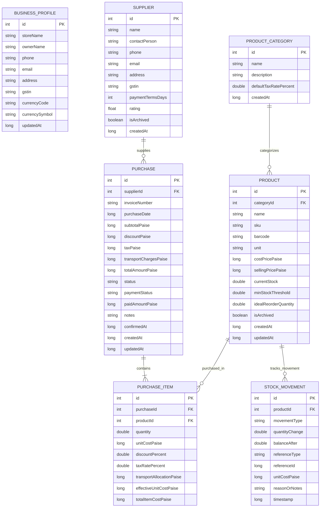

# StockQ — Database Architecture & Schema Specification

**Product**: StockQ  
**Application ID**: `com.stockq`  
**Database Name**: `stockq.db`  
**Engine**: SQLite via AndroidX Room 2.8.5 with KSP  
**Date**: October 30, 2026  

---

## 1. Architectural Principles

1. **Exact Integer Monetary Representation**:
   - Every financial column (cost price, selling price, subtotal, discount, tax, transport charges, effective cost) is stored as **paise** (`Long`).
   - 1 Indian Rupee = 100 paise (`₹ 1.00 = 100L`).
   - Floating-point (`Float` or `Double`) is strictly forbidden for financial arithmetic to avoid IEEE-754 binary rounding discrepancies.
2. **Immutable Audit Ledger**:
   - Stock balances are never altered by loose updates. Every stock increment or decrement is recorded as an immutable `StockMovement` row.
3. **Transaction Safety**:
   - Business operations modifying multiple tables (e.g. Confirming a purchase and posting inventory movements) are executed inside `@Transaction` blocks.
4. **Relational Integrity**:
   - Foreign key constraints enforce referential integrity (`RESTRICT` on products referenced in stock movements or purchases, `CASCADE` on purchase line items, `SET_NULL` on category deletion).

---

## 2. Entity Relationship Diagram

---

## 3. Financial Calculation Standards

- **Item Total Cost**:
  $$\text{base} = \text{round}(\text{quantity} \times \text{unitCostPaise})$$
  $$\text{discount} = \text{round}(\text{base} \times \frac{\text{discountPercent}}{100})$$
  $$\text{tax} = \text{round}((\text{base} - \text{discount}) \times \frac{\text{taxRatePercent}}{100})$$
  $$\text{totalItemCostPaise} = \text{base} - \text{discount} + \text{tax} + \text{transportAllocationPaise}$$
- **Effective Unit Cost**:
  $$\text{effectiveUnitCostPaise} = \text{round}\left(\frac{\text{totalItemCostPaise}}{\text{quantity}}\right)$$

