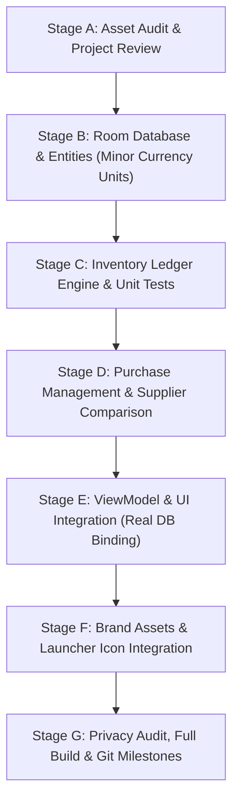

# StockQ — Phase 1 Project Code Review & Architecture Strategy

**Product**: StockQ  
**Application ID**: `com.stockq` (configured via `build.gradle.kts`)  
**Developer**: SuBZeRo  
**Date**: October 30, 2026  
**Auditor**: Lead Android Architect & DevOps Specialist  

---

## 1. Current State Assessment

### 1.1 Project Structure & Build Configuration
- **Gradle & AGP**: Gradle 9.1.0 with Android Gradle Plugin 9.0.1.
- **Kotlin & Compose**: Kotlin 2.3.20 with integrated Jetpack Compose Compiler plugin and Compose BOM 2026.03.01.
- **Symbol Processing & ORM**: KSP 2.3.12 with Room 2.8.5.
- **Memory Tuning**: Tuned to `-Xmx1024m` with Serial GC (`-XX:+UseSerialGC`) to guarantee stability on the Windows 11 host with 2.28 GB free RAM.
- **Application ID Note**: The user directive specifies `Application ID: com.stockq`. We will update `defaultConfig.applicationId = "com.stockq"` in `app/build.gradle.kts` while preserving `namespace = "com.stockq"` for seamless Kotlin package alignment.

### 1.2 Scaffold Review & Identified Gaps
1. **Database Layer (Empty)**:
   - No Room entities, DAOs, or database class are currently implemented.
   - Screen composables currently display static or hardcoded zero counters.
2. **Missing Core Entities**:
   - `BusinessProfile` (store metadata, currency, tax preference)
   - `Product` (SKU, barcode, name, unit, cost price, selling price, min stock threshold, category foreign key)
   - `ProductCategory` (classification, tax rate)
   - `Supplier` (name, phone, address, terms)
   - `Purchase` (supplierId, invoiceNumber, purchaseDate, subtotal, discount, tax, transportCost, totalAmount, status: DRAFT vs CONFIRMED)
   - `PurchaseItem` (purchaseId, productId, quantity, unitCost, discount, taxRate, totalCost)
   - `StockMovement` (productId, movementType: OPENING, PURCHASE, SALE, ADJUSTMENT, DAMAGE, RETURN, quantityChange, balanceAfter, referenceId, notes, timestamp)
3. **Financial Precision Requirement**:
   - Using `Float` or `Double` for financial values risks floating-point rounding discrepancies (e.g. `0.1 + 0.2 != 0.3`).
   - All financial amounts must be represented as **integer minor currency units** (i.e. **paise** as `Long`, where `₹ 1.00 = 100 paise`).
4. **Inventory Engine & Stock Ledger Rules**:
   - Stock balance must never be arbitrarily updated via a loose `UPDATE product SET stock = stock + X` without an immutable, auditable `StockMovement` ledger entry.
   - Confirming a purchase must execute in an **atomic Room transaction** that writes both the `PurchaseItem` records, marks the purchase `CONFIRMED`, and generates corresponding `PURCHASE` stock movements.
   - Cancellation must generate compensatory adjustment movements rather than silently wiping history.

---

## 2. Proposed Phase 1 Implementation Sequence

1. **Stage B: Room Database Foundation**:
   - Implement entities with foreign keys, index optimization, and type converters.
   - Implement DAOs with Kotlin Coroutines Flow for reactive UI streaming.
   - Implement database instance with schema versioning.
2. **Stage C: Inventory Engine**:
   - Implement `StockLedgerRepository` ensuring every stock update creates an auditable `StockMovement`.
   - Comprehensive JVM unit tests for stock ledger math, negative-stock policies, and low-stock recalculations.
3. **Stage D: Purchase & Supplier Management**:
   - Implement `PurchaseRepository` with atomic confirmation and reversal transactions.
   - Implement `SupplierComparisonRepository` with transparent effective unit cost calculations.
4. **Stage E: ViewModel & UI Integration**:
   - Connect Dashboard, Inventory, Add/Edit Product, Details, Movement, Purchases, Suppliers, Comparison, Reorder, and Settings to Live ViewModels.
5. **Stage F: Brand Asset Integration**:
   - Export 1024×500 Google Play Feature Graphic.
   - Integrate launcher mipmaps and in-app brand logos.
6. **Stage G: Verification & Privacy Audit**:
   - Verify zero internet permissions in final merged manifest.
   - Run `gradlew.bat clean testDebugUnitTest assembleDebug`.

