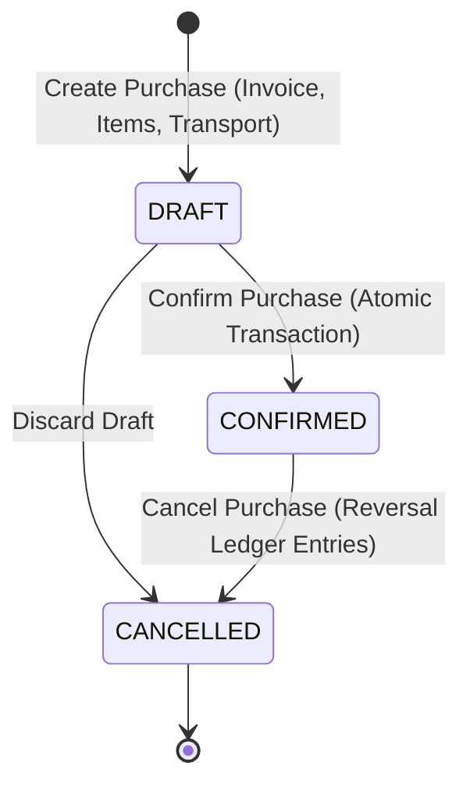

# StockQ — Purchase Management & Supplier Comparison

**Product**: StockQ  
**Application ID**: `com.stockq`  
**Developer**: SuBZeRo  
**Date**: October 30, 2026  

---

## 1. Purchase Lifecycle & State Machine

### 1.1 Inward Stock Isolation (Draft State)
- While in `DRAFT`, purchases do **NOT** modify physical inventory.
- Quantities, prices, discounts, and transport allocations may be edited freely.

### 1.2 Confirmation Transaction (Atomic)
- When confirmed:
  1. Validates that the purchase is strictly in `DRAFT` status and contains at least 1 item.
  2. Verifies that zero prior stock movements exist for this purchase ID (prevents double confirmation).
  3. Iterates over line items and calculates `newStock = product.currentStock + item.quantity`.
  4. Inserts `StockMovement(type = PURCHASE_RECEIPT, ref = "PURCHASE", refId = purchaseId)`.
  5. Updates `Product.currentStock = newStock` and updates `Product.costPricePaise = item.effectiveUnitCostPaise`.
  6. Sets `Purchase.status = CONFIRMED`, `Purchase.confirmedAt = now()`.

### 1.3 Cancellation & Reversal
- If a `CONFIRMED` purchase is cancelled:
  1. Checks that sufficient inventory remains to reverse (cannot reverse if stock was already sold into negative numbers).
  2. Inserts compensatory `SUPPLIER_RETURN` movements (`quantityChange = -item.quantity`).
  3. Updates `Product.currentStock`.
  4. Marks `Purchase.status = CANCELLED`.

---

## 2. Supplier Comparison Matrix

StockQ compares recorded wholesale purchases and supplier quotations for identical SKUs:

| Metric | Calculation Method |
|---|---|
| **Base Price** | `unitCostPaise` (as quoted by vendor) |
| **Trade Discount** | Deducted from line item before taxation |
| **Applicable Tax** | Calculated on net discounted base |
| **Allocated Transport** | Freight charges allocated pro-rata across invoice line items by value |
| **Effective Unit Cost** | $\frac{\text{Net Cost} + \text{Tax} + \text{Allocated Transport}}{\text{Quantity}}$ |

Only quotes with identical measurement units (e.g. `pcs` vs `pcs`, not `pcs` vs `kg`) are directly compared.

