# StockQ — Security & Privacy Configuration Report

**Product**: StockQ  
**Developer**: SuBZeRo  
**Application ID**: `com.subzero.stockq`  
**Workspace**: `G:\StockQ`  
**Date**: October 30, 2026  

---

## 1. Architectural Privacy Tenets

StockQ is built from the ground up as an **offline-first, zero-surveillance business application**. It guarantees that a shopkeeper or business owner has 100% data sovereignty over their inventory, pricing, profit margins, and supplier records.

| Tenet | Implementation | Verification Method |
|---|---|---|
| **Zero Network Permission** | The `AndroidManifest.xml` explicitly omits `android.permission.INTERNET` and `ACCESS_NETWORK_STATE`. | Manifest inspection & APK analysis |
| **No Telemetry or Tracking** | Zero third-party analytics libraries (Firebase, Mixpanel, etc.). | Dependency tree audit |
| **No Advertising** | Zero ad networks or tracking identifiers. | Dependency tree audit |
| **No Account Creation** | No sign-in, email, phone number, or OTP required. | App architecture |
| **Strict Local Storage** | All records are stored exclusively in an internal SQLite database (`/data/data/com.subzero.stockq/databases/stockq.db`). | Room Database configuration |
| **User-Controlled Backup** | Backup and restore operate via Android's Storage Access Framework (`ACTION_CREATE_DOCUMENT` / `ACTION_OPEN_DOCUMENT`). The user chooses exactly where to save or load their file. | SAF integration |
| **Disabling Automatic Cloud Backup** | `android:allowBackup="false"` in `AndroidManifest.xml` prevents the Android operating system from automatically uploading private business data to Google Drive. | AndroidManifest & Backup Rules |

---

## 2. Backup Rules Configuration

To provide deliberate, fine-grained control:
- `res/xml/data_extraction_rules.xml`: Disallows cloud transfer, allows device-to-device migration only if initiated by the user.
- `res/xml/backup_rules.xml`: Explicitly excludes the SQLite database directory from unencrypted system backups.

---

## 3. Data Protection Summary

```mermaid
flowchart LR
    User["Shopkeeper / User"] -->|Direct Interaction| UI["StockQ UI (Compose)"]
    UI -->|Unidirectional Flow| VM["ViewModel"]
    VM -->|Domain Logic| Repo["Repository"]
    Repo -->|Local Read/Write| Room["Local SQLite DB (On Device)"]
    Room -.->|User-Initiated SAF Export| ExternalFile["Encrypted / Raw JSON or DB File on User Storage"]
    style Room fill:#1E3A8A,stroke:#38BDF8,stroke-width:2px,color:#fff
    style ExternalFile fill:#0D9488,stroke:#2DD4BF,stroke-width:2px,color:#fff
```

No data packets ever leave the physical device.
